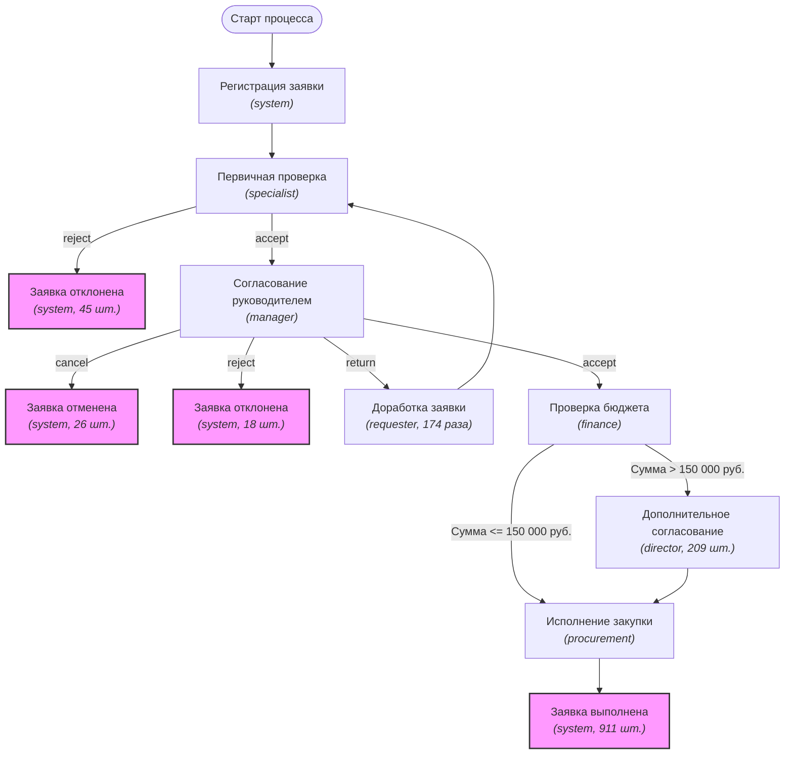

# Итоговый отчёт по производственной практике 2026

**Организации-партнёры практики**: 
* **ELMA** (разработчик Low-code / BPM-платформы корпоративной автоматизации ELMA365)
* **Синаптик** (разработчик клиент-серверных интернет-сервисов и мобильных приложений)

**Исполнитель**: ChampagneXiter  
**Профиль GitHub**: [github.com/ChampagneXiter](https://github.com/ChampagneXiter)  
**Рабочий период**: 2026 год  

---

## 📌 Навигация по репозиториям кейсов

Каждое задание производственной практики оформлено в виде отдельного публичного репозитория, содержащего программный код на Python, сгенерированные файлы результатов по установленным шаблонам и подробные аналитические отчёты:

| Кейс | Репозиторий на GitHub | Тематика задания | Сдаваемые артефакты |
|---|---|---|---|
| **Кейс 1: ЭЛМА** | [ChampagneXiter/proizvodstvennaya-praktika-1](https://github.com/ChampagneXiter/proizvodstvennaya-praktika-1) | Поиск аномалий и нетипичного поведения в закупках | `anomalies.csv`, `report.md`, `generate_case1_solution.py` |
| **Кейс 2: ЭЛМА** | [ChampagneXiter/proizvodstvennaya-praktika-2](https://github.com/ChampagneXiter/proizvodstvennaya-praktika-2) | Восстановление схемы процесса (Process Discovery) | `variants_template.csv`, `student_transitions_template.csv`, `report.md`, `generate_case2_solution.py` |
| **Кейс 3: Синаптик** | [ChampagneXiter/proizvodstvennaya-praktika-3](https://github.com/ChampagneXiter/proizvodstvennaya-praktika-3) | Продуктовая аналитика и проверка гипотез интернет-сервиса | `report.md`, `analysis.py`, таблицы метрик и схемы БД |

---

## 📋 Содержание

1. [Общие цели и используемый стек](#общие-цели-и-используемый-стек)
2. [Кейс 1 (ЭЛМА): Поиск нетипичного поведения заявок на закупку](#кейс-1-элма-поиск-нетипичного-поведения-заявок-на-закупку)
   * 2.1. Методология исследования и базовая модель
   * 2.2. Система критериев аномальности
   * 2.3. Результаты и структура выявленных аномалий (56 процессов)
   * 2.4. Анализ редких событий (аудит) и открытых заявок
3. [Кейс 2 (ЭЛМА): Восстановление процесса по журналу событий (Process Discovery)](#кейс-2-элма-восстановление-процесса-по-журналу-событий-process-discovery)
   * 3.1. Схема восстановленного бизнес-процесса
   * 3.2. Ключевые развилки и пороговые условия (150 000 руб.)
   * 3.3. Варианты выполнения (8 трасс) и граф переходов (12 связей)
4. [Кейс 3 (Синаптик): Генерация и проверка продуктовых гипотез](#кейс-3-синаптик-генерация-и-проверка-продуктовых-гипотез)
   * 4.1. Анализ боевого датасета сервиса Pipster VPN
   * 4.2. Гипотеза 1: Мультиаккаунтинг и абуз триал-периодов
   * 4.3. Гипотеза 2: Воронка конверсии и органические покупки
   * 4.4. Гипотеза 3: Катастрофический сбой эквайринга (упущенная выручка 17.3 млн руб.)
   * 4.5. Гипотеза 4: Инфраструктурные сбои развёртывания нод Xray / Remna
   * 4.6. Гипотеза 5: Оптимизация лимитов бесплатного тарифа (500 Мб)
5. [Итоги производственной практики](#итоги-производственной-практики)

---

## 🛠 Общие цели и используемый стек

В ходе производственной практики были решены три разноплановые задачи на стыке анализа данных, Process Mining и продуктовой аналитики:
1. **Process Anomaly Detection**: выявление инцидентов мошенничества, обхода регламентов и ошибок исполнения в бизнес-процессах.
2. **Process Discovery**: извлечение скрытой топологии, развилок, циклов и пороговых условий процесса из «сырых» логов событий.
3. **Product & Subscription Analytics**: исследование юнит-экономики, поведения пользователей, платёжных воронок и инфраструктурных инцидентов реального Highload-продукта.

### Инструментальный стек:
* **Язык программирования**: Python 3.14.
* **Анализ данных**: `pandas`, `numpy`, `scipy`.
* **Моделирование процессов**: Process Mining / Direct-Follows Graphs (DFG), BPMN, Mermaid.
* **Контроль версий**: Git, GitHub.

---

## 🔍 Кейс 1 (ЭЛМА): Поиск нетипичного поведения заявок на закупку

* **Репозиторий**: [ChampagneXiter/proizvodstvennaya-praktika-1](https://github.com/ChampagneXiter/proizvodstvennaya-praktika-1)
* **Исходные данные**: нормализованный журнал `students.csv` (12 162 события по 1 000 уникальным заявкам за период с 12.01.2026 по 30.06.2026).
* **Срез наблюдения**: 1 июля 2026 года, 00:00 (UTC+03:00).

### 2.1. Методология исследования и базовая модель

На первом этапе была проведена хронологическая сортировка событий по составному ключу `(ProcessInstanceId, EventIndex)`, сопоставлены пары событий `task_created` и `task_completed` по `TaskId` и рассчитаны точные длительности этапов.

Анализ 944 штатных процессов позволил восстановить нормальное поведение:
* **Стандартный Happy Path**:
  $$\text{Регистрация} \xrightarrow{\text{system}} \text{Проверка заявки} \xrightarrow{\text{specialist}} \text{Согласование} \xrightarrow{\text{manager}} \text{Бюджет} \xrightarrow{\text{finance}} \text{Исполнение} \xrightarrow{\text{procurement}} \text{fulfilled}$$
* **Особенность договоров (`contract`)**: между согласованием бюджета и исполнением обязательно проводится `Проверка договора (legal)`.
* **Регламент доработок**: при возврате заявка направляется инициатору (`requester`), после чего повторно проходит проверку специалистом и согласование руководителем. В 93.7% нормальных случаев возврат происходит **ровно 1 раз**.
* **Временные нормы**: медианная длительность человеческой задачи составляет **1.83 часа** (6 581 сек.), все задачи выполняются строго в рабочее время (09:00–18:00).

### 2.2. Система критериев аномальности

Для детекции нарушений были разработаны 6 строгих правил:

| Тип отклонения | Механика в данных | Бизнес-риск |
|---|---|---|
| **Неправомерная роль согласующего** | `ActivityName == 'Согласование руководителем'` при `Role == 'requester'` | Конфликт интересов (SoD): заявитель сам утвердил свою заявку. |
| **Пропуск обязательного этапа** | Процесс закрыт со статусом `fulfilled`, но этап руководителя отсутствует | Обход управленческого контроля: деньги выделены без ведома руководства. |
| **Нарушение последовательности этапов** | `Исполнение заявки` выполнено ДО согласования бюджета финансистом | Кассовый разрыв: закупщик потратил средства до одобрения бюджета. |
| **Аномальное зацикливание доработок** | Число возвратов на доработку $\ge 5$ раз в рамках одного процесса | Зацикливание процесса, некомпетентность либо попытка манипуляций. |
| **Аномально быстрое согласование** | Человеческие этапы закрыты за $< 20$ сек. (среднее по заявке $< 60$ сек.) | Невозможность фактической проверки документов (скриптовое/фиктивное закрытие). |
| **Зависший процесс** | Заявка открыта, последняя активность была $> 100$ дней назад | Заброшенный процесс (с января–февраля 2026 г., более 140–160 дней простоя). |

### 2.3. Результаты и структура выявленных аномалий

Алгоритмический анализ скриптом `generate_case1_solution.py` выявил ровно **56 уникальных аномальных процессов**:

```
Пропуск обязательного этапа:            16 процессов
Неправомерная роль согласующего:         8 процессов
Нарушение последовательности этапов:     8 процессов
Аномальное зацикливание доработок:       8 процессов
Аномально быстрое согласование:          8 процессов
Зависший процесс:                        8 процессов
------------------------------------------------------
ИТОГО аномальных процессов:              56 процессов
```

Каждая аномалия зафиксирована в `anomalies.csv` с идентификатором процесса, типом и проверяемым фактологическим объяснением (номера событий, задействованные роли, точные таймлайны).

### 2.4. Анализ редких событий (аудит) и открытых заявок

В отчёте детально обосновано различие между нарушением и редким допустимым поведением:
1. **Внеплановая проверка аудитором (`auditor`)**:
   * Наблюдается в 8 процессах (аудитор подключается дважды: после руководителя и после бюджета).
   * **Вывод**: это **не аномалия**, а легитимный механизм внепланового выборочного контроля. Все стандартные этапы соблюдены, роли не нарушены.
2. **Открытые заявки**:
   * Всего не завершено 10 заявок. 2 из них (`f273e429-...` и `70cfce39-...`) созданы во второй половине дня 30 июня 2026 г. (за несколько часов до среза) — это нормальный рабочий процесс.
   * Оставшиеся 8 заявок висят с января–февраля ($>140$ дней) — они отнесены к зависшим аномалиям.

---

## 📊 Кейс 2 (ЭЛМА): Восстановление процесса по журналу событий (Process Discovery)

* **Репозиторий**: [ChampagneXiter/proizvodstvennaya-praktika-2](https://github.com/ChampagneXiter/proizvodstvennaya-praktika-2)
* **Исходные данные**: журнал `students.csv` (6 508 событий по 1 000 завершённым заявкам).
* **Сдаваемые файлы**: `variants_template.csv`, `student_transitions_template.csv`, `report.md`.

### 3.1. Схема восстановленного бизнес-процесса

По фактическим трассам была детерминированно извлечена и построена схема наблюдаемого поведения:



### 3.2. Ключевые развилки и пороговые условия

1. **Развилка на директора (Порог 150 000 руб.)**:
   * Анализ распределения поля `Amount` показал идеальное разделение:
     * Максимальная сумма без директора: **149 743.41 руб.**
     * Минимальная сумма с директором: **150 614.59 руб.**
   * Ровно при превышении **150 000 руб.** требуется `Дополнительное согласование` (директор). Ни одна заявка с меньшей суммой не ушла директору, и ни одна с большей суммой не миновала директора (всего 209 случаев).
2. **Развилки завершения**:
   * Специалист может только принять (`accept`) или отклонить (`reject` $\rightarrow$ 45 отказов).
   * Руководитель обладает расширенными полномочиями: принять (`accept`), вернуть (`return`), отклонить (`reject` $\rightarrow$ 18 отказов) или отменить заявку (`cancel` $\rightarrow$ 26 отмен).
3. **Контур доработки**:
   * Заявка после доработки инициатором **всегда** возвращается специалисту на первичную проверку, а не сразу руководителю.

### 3.3. Варианты выполнения (8 трасс) и переходы (12 пар)

Все 1 000 заявок укладываются ровно в **8 вариантов маршрутов**:
* **Variant 1 (56.7%)**: базовый Happy Path без возвратов до 150 тыс. руб.
* **Variant 2 (18.8%)**: закупки свыше 150 тыс. руб. с директором.
* **Variant 3 (11.7%)**: 1 возврат на доработку (сумма до 150 тыс. руб.).
* **Variant 4 (4.5%)**: отказ специалиста на первичном этапе.
* **Variant 5 (2.6%)**: отмена руководителем.
* **Variant 6 (2.1%)**: 1 возврат на доработку + согласование директора (>150 тыс. руб.).
* **Variant 7 (1.8%)**: 2 возврата на доработку.
* **Variant 8 (1.8%)**: отказ руководителя.

Граф непосредственного следования (Direct-Follows Graph) содержит ровно **12 уникальных пар переходов**, зафиксированных в `student_transitions_template.csv`.

---

## 💡 Кейс 3 (Синаптик): Генерация и проверка продуктовых гипотез

* **Репозиторий**: [ChampagneXiter/proizvodstvennaya-praktika-3](https://github.com/ChampagneXiter/proizvodstvennaya-praktika-3)
* **Исходные данные**: боевой продакшн-дамп базы данных интернет-сервиса подписок **Pipster VPN** (136 006 заказов, 69 968 подписок, логи нод Xray/Remna, метрики SaaS).
* **Сдаваемые файлы**: `report.md`, `analysis.py`, таблицы метрик и структуры БД.

### 4.1. Анализ боевого датасета

В отличие от учебных симуляций, датасет компании «Синаптик» представляет собой срез реального Highload-продукта:
* **Мобильные клиенты**: Android, iOS, Huawei, Windows, macOS.
* **Стек обхода блокировок**: бэкенд на базе **Remnawave**, протоколы **VLESS + TCP + Reality + XHTTP**.
* **Тарифная сетка**: бесплатный тариф `Basic`, `Lite` ($4.49 / 249 руб. — **91.3% всех продаж**), `Silver` ($8.99), `Gold` ($12.49), `Diamond` ($21.99).
* **Пробный период (Trial)**: 3 дня (72 часа) за 1.00 USD.

### 4.2. Пять подтверждённых продуктовых гипотез

#### 🟢 Гипотеза 1: Мультиаккаунтинг и абуз триал-периодов
* **Данные**: внутри одной учетной записи `user_id` повторный триал невозможен (у 22 188 из 22 193 пользователей зафиксирован ровно 1 триал). При этом **43.3% пользователей (9 605 чел.)** после 3 дней триала навсегда покидают сервис.
* **Выявление абуза**: сопоставление `devices.csv` (`appmetrica_device_id`) и `saved_payment_methods.csv` (хэши карт) позволяет выявлять пользователей, создающих новые аккаунты на том же телефоне с той же карты.
* **Решение**: блокировка повторного триала по Device ID + отпечатку карты, с автоматическим предложением приветственной скидки 30% на месячный тариф.

#### 🟢 Гипотеза 2: Воронка конверсии и органические покупки
* **Данные**: всего в сервисе 29 022 платящих пользователя.
* **Ключевой вывод**: триал — сильнейший двигатель продаж: **конверсия из триала в регулярную подписку составляет 56.7%** (12 588 чел.).
* **Срок конверсии**: медиана времени между триалом и покупкой составляет ровно **3.001 дня (72 часа)**, что доказывает безупречную работу механизма автопролонгации (recurring).
* **Органические покупки**: **23.5% аудитории (6 829 чел.)** покупают подписку сразу без триала. Им выгодно предлагать годовые планы со скидкой на первом экране.

#### 🟢 Гипотеза 3: Катастрофический сбой эквайринга (Lost Revenue 17.3 млн руб.)
* **Данные**: из 136 006 заказов **53 929 заказов (39.6%) имеют статус `failed`**!
* **Причина**: 99.8% транзакций идут через платёжного провайдера №2, где процент отказов достигает **40.0%**.
* **Финансовый ущерб**: фактически получено 14.9 млн руб., а **упущено из-за сбоев оплаты 17.3 млн руб.**!
* **Решение**: внедрение каскадного эквайринга (Smart Routing на альтернативных провайдеров) и логики повторных списаний (Dunning logic через 12, 24 и 48 часов).

#### 🟢 Гипотеза 4: Инфраструктурные инциденты развёртывания нод
* **Данные**: в `task_history.csv` зафиксированы повторяющиеся сбои генерации протокола `PAID_VLESS_TCP_REALITY_XHTTP`.
* **Причина**: ошибка валидации в Remna API: `invalid: remark (string: len 41 greater than maximum 40)`. Превышение лимита в 40 символов в имени хоста приводило к сбою развёртывания серверов.
* **Решение**: ограничение длины суффикса `remark` до 32 символов и автоматический пречекинг SSH-доступа перед включением ноды в кластер.

#### 🟢 Гипотеза 5: Оптимизация лимитов бесплатного тарифа
* **Данные**: базовый лимит 500 Мб/день слишком мал для современного медиа-трафика (исчерпывается за 15–20 минут видео), из-за чего пользователи бросают приложение до знакомства с качеством связи.
* **Решение**: внедрение механики **Rewarded Ads**: +300 Мб за просмотр короткого видеоролика (до 3 раз в день). Это максимизирует eCPM и конвертирует активных пользователей на безлимитный тариф `Lite` (8 руб./день).

---

## 🎯 Итоги производственной практики

1. Все три кейса решены в строгом соответствии с требованиями заданий.
2. Подготовлены воспроизводимые скрипты на Python (`generate_case1_solution.py`, `generate_case2_solution.py`, `analysis.py`), гарантирующие проверяемость каждого вывода.
3. Все артефакты, таблицы и отчёты загружены в отдельные публичные репозитории на GitHub:
   * [proizvodstvennaya-praktika-1](https://github.com/ChampagneXiter/proizvodstvennaya-praktika-1)
   * [proizvodstvennaya-praktika-2](https://github.com/ChampagneXiter/proizvodstvennaya-praktika-2)
   * [proizvodstvennaya-praktika-3](https://github.com/ChampagneXiter/proizvodstvennaya-praktika-3)
